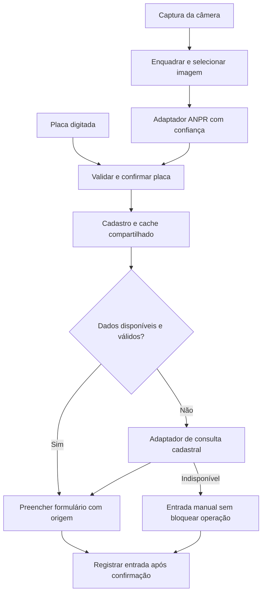

# Análise técnica do sistema de estacionamento

Data: 12/11/2026. Escopo: código desta cópia do repositório, configuração local sem exposição de segredos, testes isolados e documentação pública dos fornecedores. Não foram alterados os fluxos da aplicação nem os dados do estacionamento.

## 1. Diagnóstico principal

O problema relatado tem duas partes independentes:

1. **Consulta cadastral:** recebe uma placa em texto e busca marca, modelo e cor.
2. **Reconhecimento ANPR/OCR:** recebe uma imagem e tenta descobrir o texto da placa.

No primeiro fluxo, o sistema depende exclusivamente de um endereço legado fixo. Na consulta pública realizada, `https://apicarros.com/v1/consulta/` apresentou uma página de domínio possivelmente à venda, sem documentação de API. Isso é evidência de que essa dependência precisa ser substituída e homologada; não é uma medição da disponibilidade de produção do usuário. A tentativa de abrir o endpoint com placa sintética pela ferramenta de pesquisa não forneceu resposta HTTP utilizável.

No segundo fluxo, a configuração local não contém `ANPR_URL`, `ANPR_API_KEY` nem `ANPR_FAKE_PLATE`; essas variáveis também não estavam definidas no processo de análise. No celular, o OCR local está explicitamente desativado. No computador, a inicialização do Tesseract usa argumentos incompatíveis com a versão 5 carregada no HTML.

As mensagens genéricas escondem essas diferenças e fazem ausência de configuração, indisponibilidade e ausência de dados parecerem o mesmo problema.

Fonte da observação externa: [página do domínio usado no código](https://apicarros.com/v1/consulta/).

## 2. Consulta externa de placas

### 2.1. Dependência fixa e configuração sem efeito — prioridade P0

**Evidência:** `backend/server.js:73` define `FREE_API` diretamente. Em `backend/server.js:205`, a URL é construída como `https://apicarros.com/v1/consulta/{placa}.json`.

Embora `.env.example` mencione `API_CARROS_URL`, o backend não lê essa variável. Também não existe adaptador, chave de consulta cadastral ou segunda integração ativa. A descrição de `backend/package.json` menciona outro fornecedor e diverge do código.

**Melhoria:** selecionar um fornecedor documentado, validar autenticação e payload em homologação e implementar um adaptador específico. Variáveis propostas: `VEHICLE_LOOKUP_PROVIDER` e a credencial própria do fornecedor. A mesma interface interna pode admitir um segundo fornecedor posteriormente, com controle de custo e política de acionamento.

Trocar apenas a URL não resolve: método HTTP, autenticação e formato de resposta variam.

### 2.2. Erros externos viram sucesso HTTP — P0

**Evidência:** `backend/server.js:189` devolve HTTP 200 com `encontrado: false` para a maioria das falhas. Um teste com resposta externa 401 reproduziu esse comportamento. Falhas de JSON também caem na mesma resposta genérica.

O operador não consegue distinguir token incorreto, saldo, limite de uso, timeout, HTML inesperado ou placa realmente ausente.

**Melhoria:** definir estados internos estáveis, como `found`, `not_found`, `not_configured`, `provider_error`, `quota_exceeded` e `timeout`. Retornar um `requestId`, preservar informações de diagnóstico no servidor e mostrar uma mensagem de ação na interface. Não encaminhar cegamente os códigos do fornecedor: um 401 da credencial do backend deve ser classificado como falha de integração, não como necessidade de login do operador.

Ausência legítima de dados pode seguir um contrato de resultado de domínio; indisponibilidade sem cache deve ser distinguível, por exemplo por HTTP 503/504. Cache válido pode ser devolvido com HTTP 200, origem e aviso de atualização pendente.

### 2.3. Parser restrito — P0 na migração

**Evidência:** `backend/server.js:232` lê apenas `data.marca`, `data.modelo` e `data.cor`. Testes isolados confirmaram que campos em maiúsculas e o envelope `basico.dados` não são interpretados.

**Melhoria:** cada adaptador deve validar o esquema documentado e converter a resposta para um contrato interno. Não procurar campos arbitrariamente em qualquer nível de JSON, pois isso pode transformar um erro em dado aparentemente válido.

### 2.4. Cache ineficiente e sem procedência suficiente — P1

**Evidência:** `backend/server.js:162` busca o último histórico, mas o backend chama a API mesmo quando esse registro tem dados. Quando usa esse histórico como reserva, retorna `encontrado: false`. O frontend atual ainda aproveita campos preenchidos, portanto o defeito não significa descarte obrigatório do cache; significa contrato ambíguo.

Em `frontend/script.js:297`, existe outro cache em `localStorage`. O campo `updated` é gravado, mas não é usado para expiração. Registros manuais e respostas de API compartilham o mesmo formato. Uma resposta bem-sucedida da consulta só chega ao cache do servidor depois que houver um registro de entrada correspondente.

**Melhoria:** criar um cadastro/cache de veículos separado das estadias, com placa, dados, fonte, instante da consulta, validade e indicação de revisão manual. Consultar o cache compartilhado antes da API. Expiração de 7–30 dias pode ser um ponto inicial, dependendo do contrato do fornecedor e da necessidade operacional; não deve ser uma regra universal. Permitir atualização explícita e preservar correções manuais identificadas.

### 2.5. Respostas fora de ordem podem trocar dados de veículos — P0

**Evidência:** `frontend/script.js:351` não confere se a placa ainda é a mesma depois do `await`. Um teste iniciou a consulta A, mudou para B e resolveu B antes de A: a placa B ficou com os dados de A.

**Melhoria:** cancelar a consulta anterior com `AbortController`, usar uma sequência de requisições e conferir placa e sequência antes de preencher os campos. Limpar dados vinculados à placa anterior e respeitar edições manuais feitas durante a consulta.

### 2.6. Validação e orçamento de tempo — P1

**Evidência:** a consulta no backend rejeita apenas placas com menos de sete caracteres; um teste mostrou que uma sequência numérica de oito caracteres alcança o fornecedor. O frontend tem regex brasileira, mas isso não protege a API. O navegador espera 5 segundos, enquanto a consulta externa tem 4,5 segundos, além do tempo gasto antes dela com banco e inicialização. O timer externo é removido quando chegam os cabeçalhos, antes da leitura do corpo.

**Melhoria:** validar formatos antigo e Mercosul no servidor, aplicar timeout que cubra resposta completa e estabelecer um orçamento por operação. O limite do navegador precisa incluir upload quando houver, inicialização, banco, fornecedor e transporte. Ajustar os valores a partir dos tempos medidos, evitando apenas aumentar todos os limites.

## 3. Fornecedores candidatos

As opções abaixo foram verificadas em fontes dos próprios fornecedores. São candidatas a homologação, sem comprovação de cobertura ou latência com os veículos do estacionamento. Não foram consumidas consultas pagas.

| Finalidade | Candidato | Implicação para esta aplicação |
| --- | --- | --- |
| Marca, modelo e cor pela placa | API PLACAS | Documenta consulta básica com Bearer e resposta em blocos; exige adaptador diferente do parser atual. |
| Dados pela placa e opção de OCR | Simples API | Documenta consulta em JSON e Bearer; permite avaliar um fornecedor para as duas funções. |
| Leitura de imagem | Plate Recognizer Snapshot | É compatível com a intenção da integração ANPR atual, mas ainda exige configuração, tratamento de confiança e homologação. |

A tabela pública da API PLACAS anunciava consulta simples a R$ 0,03; a Simples API anunciava consulta cadastral a R$ 0,10. Como cenário aritmético, 3.000 consultas novas/mês representariam R$ 90 ou R$ 300, respectivamente, antes de OCR e outros custos. O gasto real depende de cache, veículos repetidos e regras de cobrança; a Simples API documenta cobrança também para retorno sem dados. Fontes: [API PLACAS — valores](https://apiplacas.com.br/valores), [Simples API — consulta](https://simplesapi.com.br/consulta-placa/), [Simples API — documentação](https://simplesapi.com.br/docs).

Para a API PLACAS, a documentação consultada descreve `GET https://wdapi2.com.br/v3/basico/{placa}`, com `Authorization: Bearer ...`, e dados no bloco `basico.dados`. Fonte: [documentação da API PLACAS](https://apiplacas.com.br/documentacao).

Minha recomendação técnica é homologar primeiro uma consulta básica documentada e manter o reconhecimento como serviço separado na arquitetura. Um mesmo fornecedor pode atender ambos, mas a aplicação precisa permitir substituí-los independentemente.

## 4. Leitura pela câmera

### 4.1. ANPR ausente no ambiente local — P0

**Evidência:** `backend/server.js:270` depende de `ANPR_URL`. Sem configuração, a rota responde com HTTP 200 e `placa: null`. Isso foi reproduzido isoladamente. Os arquivos locais e o processo inspecionados não tinham as variáveis de ANPR.

`frontend/js/plate.service.js:56` impede o OCR local em dispositivos identificados como móveis. Assim, nesse ambiente, o celular não tem mecanismo de reconhecimento disponível.

**Melhoria:** validar configuração na inicialização e oferecer um diagnóstico protegido que informe apenas presença e estado dos serviços, sem revelar chaves. Na interface, exibir indisponibilidade de configuração imediatamente, sem gastar oito tentativas com imagens.

O estado da configuração do deploy Vercel não foi inspecionado e pode ser diferente do local.

### 4.2. Inicialização incompatível com Tesseract 5 — P0 para a reserva em desktop

**Evidência:** `index.html:503` carrega Tesseract 5, enquanto `frontend/js/ocr.service.js:14` passa `{ logger: ... }` no primeiro argumento de `createWorker`. Na v5, esse argumento é o idioma. As chamadas posteriores a `loadLanguage` e `initialize` são antigas e não compensam o argumento incorreto.

**Melhoria proposta:** usar a assinatura da versão fixada, por exemplo `Tesseract.createWorker('eng', 1, { logger })`, e configurar os parâmetros em seguida. Se a inicialização falhar, limpar `workerPromise` para permitir recuperação. O teste com falha simulada confirmou que a promessa rejeitada atual impede novas inicializações.

Outro defeito em `ocr.service.js:30`: caracteres minúsculos são removidos antes de `toUpperCase()`. Uma entrada `abc1d23` foi perdida no teste. Converter para maiúsculas antes de filtrar.

Fonte: [mudanças oficiais do Tesseract 5](https://github.com/naptha/tesseract.js/issues/820).

### 4.3. Limites de tempo incompatíveis e cancelamento incompleto — P0

**Evidência:**

- `frontend/js/plate.service.js:43`: 6 segundos para a requisição do reconhecimento.
- `backend/server.js:293`: 8 segundos apenas para a chamada ANPR.
- `frontend/script.js:514`: 8 segundos para a tentativa automática completa.
- `frontend/script.js:615`: 9 segundos para a captura manual completa.
- No desktop, cada imagem ainda pode tentar OCR local por até 10 segundos.

`recognizePlateFromVideo` processa duas imagens no celular e três no desktop, sequencialmente. Esses tempos não cabem de forma consistente no limite externo. `withTimeout` usa `Promise.race`; teste confirmou que o trabalho original continua após o timeout. Quando o indicador de ocupado é liberado, a próxima tentativa pode começar enquanto a anterior ainda roda. Fechar a câmera também não cancela essas requisições.

**Melhoria:** controlador de cancelamento por sessão de câmera, uma tarefa ativa por sessão e invalidação de respostas antigas. Fechar ou reiniciar a câmera deve abortar as requisições e impedir que elas preencham o formulário depois. Para trabalho de OCR que não aceita `AbortSignal`, gerenciar worker/fila e descartar resultados por sessão; `Promise.race` sozinho não interrompe processamento.

### 4.4. Redução da imagem antes do recorte — P1

**Evidência:** `frontend/script.js:437` reduz o quadro para largura máxima de 640 pixels no celular e 960 no computador. Os recortes são feitos a partir dessa imagem já reduzida. Portanto, recortar não recupera os caracteres perdidos.

**Melhoria:** mostrar uma área de enquadramento e recortar diretamente do vídeo na resolução original. Ajustar o tamanho de envio ao número de pixels efetivamente ocupado pela placa e ao limite do serviço. Começar com câmera em 1080p quando suportado, sem considerar essa resolução uma garantia de acerto. Medir a imagem real enviada, pois `ideal` não garante a resolução obtida.

Como referência de projeto, o fornecedor Plate Recognizer recomenda aproximadamente 100 pixels de largura na própria placa. Uma placa de 120 pixels em um quadro de 1920 passa a aproximadamente 40 pixels quando o quadro inteiro é reduzido para 640. Fonte: [orientação de resolução do fornecedor](https://platerecognizer.com/lpr-camera-resolution-guide/).

O vídeo usa `object-fit: cover` em `frontend/style.css:72`. A transformação entre a área visível e as coordenadas nativas deve ser considerada ao implementar um recorte guiado.

### 4.5. Primeira resposta é aceita sem avaliar qualidade — P0/P1

**Evidência:** `backend/server.js:316` escolhe apenas `results[0].plate` e descarta confiança, alternativas e coordenadas. Um teste com primeiro candidato `xyz` de baixa confiança e segundo candidato válido de alta confiança retornou `XYZ` como placa reconhecida. O frontend também aceita qualquer texto não vazio.

**Melhoria:** validar formato, preservar confiança, candidatos e caixa da placa. Selecionar a detecção que corresponda à área de enquadramento. Para confiança insuficiente, mostrar alternativas e solicitar confirmação. Os limiares precisam ser calibrados com imagens reais; não são intercambiáveis entre fornecedores.

Enviar `regions=br` no adaptador do Plate Recognizer pode ajudar a aplicar padrões brasileiros; isso não substitui validação e não é garantia de reconhecimento. Fontes: [campos de resultado](https://guides.platerecognizer.com/docs/snapshot/results/), [códigos de país](https://guides.platerecognizer.com/docs/tech-references/country-codes/).

Comparar leituras de quadros diferentes pode ajudar quando há ambiguidade, mas deve ser condicionado à confiança e ao custo. Evitar exigir duas consultas pagas para toda leitura.

### 4.6. Excesso de chamadas e cotas — P1

**Evidência:** até oito tentativas automáticas, com duas imagens por tentativa no celular ou três no desktop. Sem sucesso e sem interrupção, o desenho permite 16 ou 24 chamadas por sessão; a ausência de cancelamento pode agravar o consumo.

Um cenário de 100 veículos/dia por 30 dias resulta em 3.000 eventos. A 16–24 chamadas por evento, seriam 48.000–72.000 chamadas, como limite ilustrativo de sessões malsucedidas. Não é o consumo medido do estacionamento.

A página pública do Plate Recognizer informa 2.500 leituras/mês no plano gratuito, contando chamadas, não veículos. Mesmo uma chamada por evento ultrapassaria esse volume no cenário descrito. Fonte: [preços do Plate Recognizer](https://platerecognizer.com/pricing/).

**Melhoria:** capturar alguns quadros localmente, selecionar o melhor por nitidez, exposição e enquadramento e enviar apenas um inicialmente. Aplicar limite por sessão, intervalo progressivo e parada imediata em erro de configuração, credencial ou cota. Contabilizar chamadas efetivas no backend, incluindo tentativas sem sucesso.

### 4.7. Ciclo de vida e operação da câmera — P1/P2

**Evidência:** `frontend/js/camera.service.js:2` usa `WeakMap`; em `stopAll`, chama `forEach` e `clear`, métodos inexistentes nessa estrutura. A falha foi reproduzida. Não identifiquei uso atual de `stopAll`, portanto trata-se de defeito latente, não de causa demonstrada da ausência de placas.

`startPreview` não encerra o stream se `video.play()` falhar; novas tentativas podem deixar recursos abertos. Há zoom 2 fixo quando suportado, sem controle do operador ou ajuste conforme enquadramento.

**Melhoria:** controlar explicitamente streams ativos, encerrar tracks em falhas e impedir câmeras de entrada e QR concorrentes. Disponibilizar seleção de câmera, zoom ajustável, lanterna quando suportada e foco contínuo conforme capacidades reais. Suspender captura quando a página ficar oculta. Oferecer envio de foto como alternativa e distinguir permissão negada, contexto sem HTTPS e câmera ocupada.

### 4.8. O adaptador ANPR não é genérico

O backend sempre monta campo `upload`, autenticação `Token` e parser de `results[].plate`. Isso se aproxima do Plate Recognizer, mas mudar `ANPR_URL` para outro serviço não garante compatibilidade. Cada fornecedor precisa de adaptador e teste de contrato.

O envio de `FormData` nativo com o `node-fetch` instalado foi verificado isoladamente: a requisição foi serializada como multipart e continha o campo `upload`. Não há evidência para atribuir a falha atual a essa combinação de bibliotecas.

As funções de teste `hint` e `ANPR_FAKE_PLATE` devem ficar restritas a ambiente de teste. Atualmente podem produzir uma placa sem reconhecimento real e sem validação de formato.

## 5. Arquitetura recomendada

Separar `plateRecognition`, `vehicleLookup` e `parkingEntry` reduz o acoplamento. Reconhecer a placa não precisa depender de encontrar o cadastro do veículo. A indisponibilidade da consulta deve permitir completar o atendimento manualmente; rever a obrigatoriedade de marca/modelo em `frontend/script.js:1152` ou oferecer preenchimento explícito como desconhecido.

O cadastro interno deve registrar fonte dos dados. Marca/modelo/cor inferidos visualmente por um produto de visão não equivalem a dados de uma base cadastral.

## 6. Outras melhorias relevantes

| Prioridade | Achado e evidência | Melhoria |
| --- | --- | --- |
| P0 | `requireAuth` libera acesso se `ADMIN_TOKEN` estiver vazio (`backend/server.js:47`). Ele está ausente no ambiente local inspecionado. | Exigir autenticação em produção, identificar operadores e definir permissões. Falha de configuração não deve liberar endpoints administrativos. |
| P0 | Histórico, pátio e mensalistas têm rotas de leitura sem autenticação, incluindo nome, telefone e CPF (`server.js:544`, `659`, `1250`). | Proteger leitura e minimizar campos devolvidos. CORS não substitui autenticação. Proteger também consultas pagas com limites por operador e origem. |
| P0 | Valores e permanência são calculados no navegador e aceitos pela saída (`server.js:420`). | Recalcular no servidor a partir da estadia e da tarifa aplicável. Validar valores finitos, não negativos e conciliar pagamentos. Descontos devem ser explícitos, autorizados e auditados. |
| P0 | Saída atualiza o histórico antes de inserir movimentos, sem transação (`server.js:457`, `475`). | Executar saída e movimentos na mesma transação. Caso contrário, falha no movimento pode deixar estadia encerrada com resposta de erro e caixa incompleto. |
| P0/P1 | Capacidade é verificada antes de inserir sem serialização (`server.js:356`); não há restrição de uma estadia ativa por placa no schema. | Proteger limite de vagas sob concorrência e criar índice único parcial para placa ativa, após tratar duplicatas existentes. Usar chave de idempotência em entrada e pagamentos. |
| P1 | Dados de formulários e banco entram em `innerHTML`, por exemplo em `frontend/script.js:1514` e `1694`. | Construir elementos com `textContent` para dados e proteger atributos. Há risco de XSS persistente; o token de administrador no `localStorage` amplia o impacto. |
| P1 | `initDb` executa schema e diversas alterações a cada inicialização; a rejeição é registrada e absorvida (`server.js:67`, `backend/db.js:22`). | Usar migrações versionadas, prontidão explícita do banco e falha controlada. Configurar limites do pool e aquisição/conexão, principalmente em execução serverless. |
| P1 | Backup inclui quatro conjuntos, mas omite auditoria, turnos e fechamentos (`server.js:1506`). Restore aceita conteúdo parcial e executa exclusões (`1527`). | Backup completo e versionado, validação antes de substituir dados, ensaio de recuperação e ajuste das sequências após restaurar IDs explícitos. |
| P1 | Busca de histórico usa `(row.valor_pago || 0).toFixed(2)` (`frontend/script.js:2012`). O `pg` retorna `NUMERIC` como string por padrão. | Normalizar tipos no contrato ou converter com `Number` antes de formatar. Valor não nulo como string pode interromper a renderização. |
| P1/P2 | Tarifas vêm de `localStorage`; dispositivos podem divergir, e falha de configuração inicial pode resultar em valores zero no cliente. | Servidor como fonte do preço e snapshot da regra aplicada na entrada, conforme política comercial definida. |
| P2 | `script.js` concentra câmera, cobrança, cadastros e relatórios. Histórico não tem paginação; atualização a cada 10 segundos pode sobrepor requisições. | Modularizar por responsabilidade, paginar consultas e sincronizar sem sobreposição, com redução de frequência em aba oculta. |
| P2 | Documentação diverge entre `.env` da raiz, `.env` do backend, `ADMIN_PASSWORD` e `ADMIN_TOKEN`. | Unificar instruções, validar configuração e oferecer um comando consistente de execução. O `dotenv/config` procura o `.env` a partir do diretório de execução por padrão. |

Os achados financeiros e de concorrência acima são de revisão estática; não executei operações no banco para demonstrá-los.

Pontos favoráveis existentes: serviços separados para câmera/placa/QR, consultas SQL parametrizadas, índices básicos, limite de upload de 4 MiB, identificador de entrada, tentativa de cache, suporte a formatos brasileiros no frontend e transação já utilizada no pagamento de mensalistas. É possível evoluir esta base sem uma reescrita completa.

## 7. Ordem de implementação

### Etapa 1 — Restaurar as integrações

1. Substituir a dependência legada por consulta básica documentada e autenticada.
2. Implementar adaptador, esquema de resposta e erros identificáveis.
3. Configurar e validar ANPR no ambiente alvo, com um teste controlado de imagem real.
4. Corrigir Tesseract, recuperação do worker e normalização.
5. Alinhar tempos, implementar cancelamento por sessão e impedir respostas fora de ordem.
6. Proteger endpoints e credenciais antes de habilitar consumo pago.

### Etapa 2 — Aumentar acerto e controlar custo

1. Recortar da imagem original com área visível de enquadramento.
2. Enviar a melhor imagem por evento, com repetição condicionada à qualidade.
3. Usar confiança, candidatos e confirmação do operador.
4. Centralizar cache com validade, fonte e atualização manual.
5. Medir custo e taxa de sucesso por evento e dispositivo.

### Etapa 3 — Fortalecer a operação

1. Cobrança calculada no servidor e saídas atômicas.
2. Idempotência e prevenção de placa ativa duplicada/lotação concorrente.
3. Proteção de dados na interface e autenticação por operador.
4. Migrações, backup completo, recuperação e observabilidade.

## 8. Critérios para homologação

- Consulta cadastral: placas antigas e Mercosul, veículo conhecido, cadastro ausente, token inválido, saldo/cota, timeout e fornecedor retornando HTML. Medir cobertura, latência e custo por consulta útil.
- Interface: trocar rapidamente de placa, digitar manualmente durante a consulta, fechar/reabrir câmera e usar dois dispositivos. Nenhuma resposta antiga deve alterar o registro atual.
- Câmera: conjunto representativo de imagens e vídeos do próprio estacionamento, por exemplo 100–200 eventos distribuídos entre dia, noite, reflexo, sujeira, motos e modelos antigos/Mercosul. Esse número é ponto inicial de ensaio, não garantia estatística de precisão.
- Medir acerto exato dos sete caracteres, falsos positivos, ausência de leitura, necessidade de correção humana, tempo por evento e chamadas por evento. Não tratar o score do fornecedor como a precisão medida do sistema.
- Validar HTTP 413 e arquivo inválido com resposta JSON; verificar dimensões e tipo real da imagem no servidor, não apenas extensão/MIME informado.
- Cobrança: tolerância, virada de hora, diária, mensalidade, repetição de requisição e falha entre saída e lançamento. Ensaiar contra banco de teste.

## 9. Verificações executadas e limites

**Executado:** leitura dos arquivos do projeto; inspeção apenas da presença de variáveis locais; verificação sintática dos nove arquivos JavaScript; execução de trechos reais em contextos isolados com respostas de fornecedor e banco simuladas; serialização multipart com a versão instalada do `node-fetch`; consulta às fontes públicas citadas.

**Reproduzido:** HTTP 401 externo mascarado como 200; cache com `encontrado: false` e chamada desnecessária; descarte de respostas em formato diferente; placa inválida encaminhada; ANPR ausente; candidato inválido de baixa confiança aceito; `hint` sem validação; falha de `stopAll`; perda de minúsculas no OCR; inicialização sem recuperação; trabalho continuando após timeout; preenchimento com resposta de placa anterior.

**Controles:** multipart funciona nesta instalação. Também conferi que a saída com tarifa zero chama `processarSaida([])` diretamente em `prepararPagamento`; a exigência de pagamento do outro botão não foi classificada como defeito desse fluxo.

**Não executado:** acesso ao banco real, chamadas pagas, inspeção de variáveis/logs de produção, teste em navegador com câmera física ou medição de precisão com fotos do local. Os testes isolados demonstram defeitos de lógica, não substituem essa homologação.

Skills consultadas para orientar a verificação: [vercel:verification](C:/Users/hygor/.codex/plugins/cache/openai-curated-remote/vercel/0.54.1/skills/verification/SKILL.md) e [vercel:env-vars](C:/Users/hygor/.codex/plugins/cache/openai-curated-remote/vercel/0.54.1/skills/env-vars/SKILL.md).
